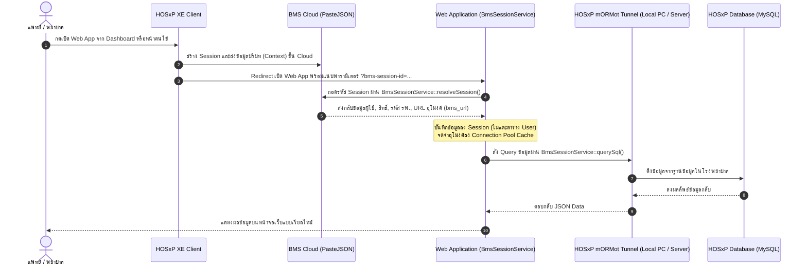

# คู่มือการใช้งานและการนำไปติดตั้ง BmsSessionService (BMS & HOSxP Integration Manual)

> **เอกสารคู่มือสำหรับนักพัฒนา:** สำหรับนำ `BmsSessionService` ไปประยุกต์ใช้งานร่วมกับระบบอื่น เพื่อเชื่อมต่อกับโปรแกรม **HOSxP XE**, ระบบคลาวด์ **BMS**, และฐานข้อมูลโรงพยาบาลผ่านระบบอุโมงค์ (mORMot Tunnel)

---

## 1. ภาพรวมสถาปัตยกรรม (Architecture Overview)

`BmsSessionService` ถูกออกแบบมาเพื่อทำหน้าที่เป็น **API Gateway กลาง** ในการสื่อสารระหว่าง Web Application ภายนอก กับระบบ **HOSxP XE** ของโรงพยาบาล โดยอาศัยเทคโนโลยี **BMS Session & mORMot Secure Tunnel** ทำให้:
1. **ไม่ต้องเปิด Public Port ของฐานข้อมูล MySQL/MariaDB ของโรงพยาบาล**
2. **ไม่ต้อง Fix ค่าการเชื่อมต่อไว้ใน `.env`** เพราะระบบจะดึง URL อุโมงค์และ Token แบบไดนามิกตามเซสชันของผู้ใช้ที่กำลังล็อกอิน
3. **รองรับ Multi-Hospital ทั่วประเทศ** โดยผู้ใช้จากแต่ละโรงพยาบาลสามารถเปิดใช้งานระบบได้พร้อมกัน
4. **Zero-Storage Privacy** สามารถยืนยันตัวตนแพทย์/พยาบาลได้โดยตรงจาก HOSxP โดยไม่ต้องสร้างข้อมูลผู้ใช้ (User) ในฐานข้อมูลของระบบเว็บ

### แผนภาพการทำงาน (Flow Diagram)



---

## 2. พารามิเตอร์ที่ได้รับจาก HOSxP และโครงสร้างข้อมูล (Payload Specification)

### 2.1 พารามิเตอร์ที่ HOSxP ส่งมาผ่าน URL
เมื่อ HOSxP สั่งเปิดหน้าเว็บ จะส่งพารามิเตอร์ผ่าน Query String ดังนี้:
- `bms-session-id` หรือ `bms-key` : UUID ของเซสชัน เช่น `D7D2F888-F442-4222-94F0-30C166F2D0F1`
- `hn` : (มีเมื่อเปิดจากหน้าเวชระเบียนผู้ป่วย) เลขที่ประจำตัวผู้ป่วย
- `vn` : (มีเมื่อเปิดจากหน้าห้องตรวจผู้ป่วยนอก) เลขที่ลำดับการรับบริการ

### 2.2 การ Resolve ข้อมูลจาก PasteJSON
`BmsSessionService` จะยิง HTTP GET ไปที่:
```http
GET https://hosxp.net/phapi/PasteJSON?Action=GET&code={bms-session-id}
```

ตัวอย่างข้อมูล JSON ที่ได้รับกลับมาจริงจาก BMS PasteJSON:
```json
{
  "MessageCode": 200,
  "Message": "OK",
  "result": {
    "system_info": {
      "version": "4.64.7.26",
      "environment": "production"
    },
    "user_info": {
      "name": "ศิริฤกษ์ คณาดี",
      "position": "นักวิชาการคอมพิวเตอร์",
      "position_id": 7,
      "hospital_code": "10989",
      "doctor_code": "101",
      "user_cid": "1341800003078",
      "user_cid_key": "53/vR7JQPQauImE+2Rqkrh8nVpx3hRzeSIOCi28SsOM=",
      "department": "งานศูนย์คอมพิวเตอร์",
      "location": "รพช. หัวตะพาน",
      "is_hr_admin": true,
      "is_director": false,
      "bms_url": "https://10989-1341800003078.tunnel.hosxp.net",
      "bms_direct_url": "http://127.0.0.1:45011",
      "bms_session_port": 33291,
      "bms_session_code": "D7D2F888-F442-4222-94F0-30C166F2D0F1",
      "bms_database_name": "hosxe",
      "bms_database_type": "MySQL"
    },
    "key_value": "D7D2F888-F442-4222-94F0-30C166F2D0F1",
    "expired_second": 36000
  }
}
```

---

## 3. รายละเอียดฟังก์ชันใน `BmsSessionService` (API Reference)

### 3.1 `resolveSession(string $sessionId): array`
- **หน้าที่:** นำรหัสเซสชันที่ได้จาก HOSxP ไปถอดรหัสเป็นข้อมูลผู้ใช้งานและ URL อุโมงค์
- **การ Cache:** ทำการ Cache ผลลัพธ์ไว้อัตโนมัติ 30 นาที เพื่อป้องกันการยิงซ้ำ
- **ตัวอย่างการเรียกใช้:**
  ```php
  use App\Services\Bms\BmsSessionService;

  $bmsService = app(BmsSessionService::class);
  $sessionData = $bmsService->resolveSession($request->input('bms-session-id'));

  $doctorName = $sessionData['name'];
  $hospCode = $sessionData['hospital_code'];
  $tunnelUrl = $sessionData['bms_url'];
  ```

---

### 3.2 `querySql(array $sessionData, string $sql, array $params = []): array`
- **หน้าที่:** ส่งคำสั่ง SQL ไปประมวลผลบน HOSxP ผ่านอุโมงค์ mORMot Tunnel (`/api/sql`)
- **ความปลอดภัย:** รองรับ Parameter Binding เพื่อป้องกัน SQL Injection
- **Fallback:** หากการยิงผ่าน Tunnel มีปัญหา และ Web App อยู่เครื่องเดียวกัน จะสลับไปยิงพอร์ตตรง `http://127.0.0.1:45011` โดยอัตโนมัติ
- **ตัวอย่างการเรียกใช้:**
  ```php
  $rows = $bmsService->querySql(
      $sessionData,
      "SELECT hn, fname, lname, cid, birthday FROM patient WHERE cid = :cid LIMIT 1",
      ['cid' => '1341800003078']
  );

  if (!empty($rows)) {
      $patient = $rows[0];
  }
  ```

---

### 3.3 `rememberHospitalSession(array $sessionData): void` และ `queryHospital(string $hospCode, string $sql)`
- **หน้าที่:** ระบบ **Hospital Connection Pool** จัดเก็บ Session ของโรงพยาบาลไว้ในแคช เพื่อให้โมดูลอื่น (เช่น ระบบออกรายงาน หรือ Cron Job) สามารถคิวรี่ข้อมูลจากโรงพยาบาลนั้นๆ ได้โดยไม่ต้องผ่านการล็อกอินซ้ำ
- **ตัวอย่างการเรียกใช้สำหรับทำรายงาน:**
  ```php
  // สั่งรันคำสั่ง SQL ไปยัง รพ. 10989 ได้ทันที
  try {
      $reportData = $bmsService->queryHospital('10989', "
          SELECT o.vstdate, COUNT(*) as total_visit 
          FROM ovst o 
          WHERE o.vstdate >= DATE_SUB(CURRENT_DATE, INTERVAL 7 DAY)
          GROUP BY o.vstdate 
          ORDER BY o.vstdate DESC
      ");
  } catch (\Exception $e) {
      // แจ้งเตือนเมื่อโรงพยาบาลยังไม่ได้เปิด HOSxP เชื่อมต่ออุโมงค์
      Log::warning("Hospital 10989 offline: " . $e->getMessage());
  }
  ```

---

### 3.4 `restGet(array $sessionData, string $table, ?string $id = null, array $queryParams = []): array`
- **หน้าที่:** อ่านข้อมูลตารางต่างๆ ของ HOSxP ผ่าน REST Resource API (`/api/rest/{table}`)
- **ตัวอย่างการเรียกใช้:**
  ```php
  // ดึงรายการหอผู้ป่วยทั้งหมด
  $wards = $bmsService->restGet($sessionData, 'ward');

  // ดึงข้อมูลยา รหัส '1000001'
  $drug = $bmsService->restGet($sessionData, 'drugitems', '1000001');
  ```

---

### 3.5 `callFunction(array $sessionData, string $functionName, array $params = []): array`
- **หน้าที่:** เรียกใช้งาน Server Functions ของ HOSxP XE (`/api/function`)
- **ตัวอย่างการเรียกใช้:**
  ```php
  // ขอเลข Serial Number จากระบบ HOSxP
  $res = $bmsService->callFunction($sessionData, 'get_serialnumber', ['name' => 'vn']);
  ```

---

### 3.6 `findPatientCid(array $sessionData, ?string $hn, ?string $vn): ?string`
- **หน้าที่:** เมื่อ HOSxP เปิดหน้าเว็บเข้ามาพร้อม `hn` หรือ `vn` แต่ระบบของเราต้องการใช้ **CID 13 หลัก** ฟังก์ชันนี้จะสั่งคิวรี่หา CID จากฐานข้อมูล HOSxP ให้ทันที
- **ตัวอย่างการเรียกใช้:**
  ```php
  $cid = $bmsService->findPatientCid($sessionData, $hn, $vn);
  if ($cid) {
      // ดำเนินการค้นหาเวชระเบียนหรือเชื่อมโยงข้อมูลต่อด้วย CID
  }
  ```

---

### 3.7 `findDoctorCid(array $sessionData): ?string`
- **หน้าที่:** ค้นหาเลขบัตรประชาชน 13 หลักของแพทย์ที่กำลังใช้งาน โดยตรวจสอบจากตาราง `doctor` ใน HOSxP ตาม `doctor_code` หรือชื่อ-นามสกุล เพื่อนำไปใช้เป็น Provider ID
- **ตัวอย่างการเรียกใช้:**
  ```php
  $doctorCid = $bmsService->findDoctorCid($sessionData);
  ```

---

### 3.8 `lookupIcd11(string $sessionId, string $query): array`
- **หน้าที่:** ค้นหารหัสโรคสากล ICD-11 ทางการแพทย์ผ่าน BMS Cloud AI Gateway
- **ตัวอย่างการเรียกใช้:**
  ```php
  $results = $bmsService->lookupIcd11($sessionId, 'Type 2 diabetes');
  ```

---

### 3.9 `canAccessModule(array $sessionData, string $moduleName = 'aemr'): bool`
- **หน้าที่:** ตรวจสอบสิทธิ์ว่าผู้ใช้งาน HOSxP มีสิทธิ์เข้าถึงระบบหรือโมดูลนั้นๆ หรือไม่ โดยอ่านนโยบายจากไฟล์ `docs/bms_allowed_modules.json`
- **รองรับ Multi-Module:** เช่น `aemr`, `reports`, `death_data`, `birth_data`
- **ตัวอย่างการเรียกใช้:**
  ```php
  if (!$bmsService->canAccessModule($sessionData, 'aemr')) {
      return view('bms.error', [
          'title' => 'จำกัดสิทธิ์เฉพาะบุคลากรทางการแพทย์',
          'message' => 'ตำแหน่งของคุณไม่มีสิทธิ์เข้าถึงระบบนี้',
          'sessionData' => $sessionData,
      ]);
  }
  ```

---

## 4. ขั้นตอนการนำไปติดตั้งในระบบอื่น (Step-by-Step Installation)

### ขั้นตอนที่ 1: คัดลอกไฟล์ Service และไฟล์สิทธิ์ JSON
1. คัดลอก `app/Services/Bms/BmsSessionService.php`
2. คัดลอก `docs/bms_allowed_modules.json` เพื่อใช้เป็นไฟล์กำหนดนโยบายสิทธิ์แบบ Multi-Module

### ขั้นตอนที่ 2: สร้าง Controller สำหรับรับ Handshake
สร้าง Controller (เช่น `app/Http/Controllers/Auth/BmsAutoLoginController.php`) เพื่อรับ Request ที่ยิงมาจาก HOSxP:

```php
<?php

namespace App\Http\Controllers\Auth;

use App\Http\Controllers\Controller;
use App\Services\Bms\BmsSessionService;
use Illuminate\Http\Request;

class BmsAutoLoginController extends Controller
{
    protected BmsSessionService $bmsService;

    public function __construct(BmsSessionService $bmsService)
    {
        $this->bmsService = $bmsService;
    }

    public function handleLaunch(Request $request)
    {
        $sessionId = $request->input('bms-session-id') ?: $request->input('bms-key');
        if (empty($sessionId)) {
            return redirect('/');
        }

        try {
            // 1. ถอดรหัสข้อมูลเซสชันจาก BMS
            $sessionData = $this->bmsService->resolveSession($sessionId);

            // 2. ตรวจสอบสิทธิ์บุคลากรจากตาราง doctor (ต้อง active = Y) และ provider_id_position ตาม docs/bms_allowed_modules.json
            $eligibility = $this->bmsService->verifyDoctorEligibility($sessionData, 'aemr');

            if (empty($eligibility['allowed'])) {
                return view('bms.error', [
                    'title'       => 'ไม่ได้รับอนุญาตให้เข้าใช้งาน',
                    'message'     => $eligibility['reason'] ?? 'ตำแหน่งของคุณไม่ได้รับอนุญาตให้เข้าถึงระบบ A-EMR',
                    'sessionData' => $sessionData,
                ]);
            }

            // 3. จัดเก็บข้อมูลตัวตนไว้ใน Session (Zero-Footprint in users table)
            session([
                'is_bms_auth'     => true,
                'auth_channel'    => 'hosxp_bms',
                'bms_user_name'   => $eligibility['name'] ?? $sessionData['name'],
                'bms_doctor_code' => $eligibility['doctor_code'] ?? ($sessionData['doctor_code'] ?? '-'),
                'bms_user_cid'    => $eligibility['cid'] ?? $sessionData['user_cid'],
                'bms_position'    => $eligibility['position'] ?? $sessionData['position'],
                'bms_hospcode'    => $sessionData['hospital_code'],
                'bms_session_id'  => $sessionId,
            ]);

            // 4. หากมีส่ง hn หรือ vn มา ให้แปลงเป็น CID
            $cid = $this->bmsService->findPatientCid(
                $sessionData, 
                $request->input('hn'), 
                $request->input('vn')
            );

            // 5. นำทางไปยังหน้าจอหลัก
            return redirect()->route('emr.viewer', array_filter(['cid' => $cid]));

        } catch (\Throwable $e) {
            return response()->view('errors.bms', ['error' => $e->getMessage()], 500);
        }
    }
}
```

### ขั้นตอนที่ 3: ลงทะเบียน Route ใน `routes/web.php`
```php
use App\Http\Controllers\Auth\BmsAutoLoginController;

// URL สำหรับรองรับการเปิดระบบจาก HOSxP (A-EMR Module)
Route::get('/bms/aemr', [BmsAutoLoginController::class, 'handleLaunch'])->name('bms.aemr');
```

---

### ขั้นตอนที่ 4: โครงสร้างโฟลเดอร์ Blade Views (รวมบริการ HOSxP ใต้ resources/views/bms)
จัดระเบียบหน้าจอที่เปิดผ่าน HOSxP ไว้ใต้โฟลเดอร์ `resources/views/bms/`:
```
resources/views/
├── layouts/
│   └── hosxp.blade.php           <-- Layout เต็มจอ ไร้กรอบ สำหรับ HOSxP
├── bms/
│   ├── error.blade.php           <-- หน้าแจ้งเตือนสิทธิ์หรือข้อผิดพลาด
│   ├── emr/
│   │   └── viewer.blade.php      <-- หน้าจอ A-EMR Clinical Viewer (@extends('layouts.hosxp'))
│   └── reports/                  <-- (ในอนาคต) หน้ารายงานสถิติ HOSxP
```

---

## 5. การตั้งค่าฝั่งโปรแกรม HOSxP XE

### แบบที่ 1: ตั้งค่าปุ่ม A-EMR ในหน้า Dashboard
1. ไปที่เมนู **ตั้งค่าระบบ (System Setting)** > **Dashboard Widget / Web Link**
2. เพิ่มรายการการเชื่อมต่อใหม่:
   - **ชื่อบริการ:** A-EMR เวชระเบียนกลาง
   - **URL:** `https://your-domain.go.th/bms/aemr`
   - **รูปแบบการส่งพารามิเตอร์:** แนบ Session ID (`bms-session-id`)

### แบบที่ 2: ตั้งค่าปุ่ม Add-on ในหน้าตรวจรักษาผู้ป่วย (Patient Tab)
1. ไปที่เมนู **Custom Tool / Patient Add-on**
2. ตั้งค่า URL ให้ส่งตัวแปรคนไข้ไปด้วย:
   - **URL:** `https://your-domain.go.th/bms/aemr?hn={HN}&vn={VN}` หรือ `https://your-domain.go.th/bms/aemr?cid={CID}`
3. เมื่อเปิดโปรแกรม ระบบ HOSxP จะแนบ `bms-session-id` พร้อม `hn`, `vn` หรือ `cid` ของผู้ป่วยปัจจุบันเข้ามาที่ระบบเว็บโดยอัตโนมัติ

---

## 6. ข้อควรระวังและแนวทางปฏิบัติด้านความปลอดภัย (Security Guidelines)

1. **การบันทึก Audit Logs (พ.ร.บ. ไซเบอร์):**
   แม้จะไม่ได้บันทึกผู้ใช้ลงในตาราง `users` แต่ทุกครั้งที่มีการกดค้นหาข้อมูลคนไข้ จะต้องบันทึก `bms_user_name`, `bms_user_cid`, `bms_hospcode`, IP Address และเหตุผลในการสืบค้นลงตาราง Audit Trail (เช่น `emr_access_logs`) ทุกครั้ง
2. **การลบ Session ID ออกจาก URL Address Bar:**
   ในหน้า Blade หรือ JavaScript ฝั่ง Client ควรใช้คำสั่ง:
   ```javascript
   if (window.history.replaceState) {
       const cleanUrl = window.location.protocol + "//" + window.location.host + window.location.pathname;
       window.history.replaceState({path: cleanUrl}, '', cleanUrl);
   }
   ```
   เพื่อไม่ให้รหัส `bms-session-id` ค้างอยู่ใน Address Bar ป้องกันการแคปภาพหน้าจอติดรหัสผ่าน
3. **การจัดการ Connection Timeout:**
   การเชื่อมต่อผ่าน mORMot Tunnel มีอายุเซสชันประมาณ 10 ชั่วโมง (`expired_second: 36000`) หากโรงพยาบาลปิดเครื่องหรือ HOSxP ปิดตัวลง อุโมงค์จะออฟไลน์ ระบบจะมี Exception ให้ตรวจสอบและแสดงข้อความแจ้งเตือนอย่างเหมาะสม
