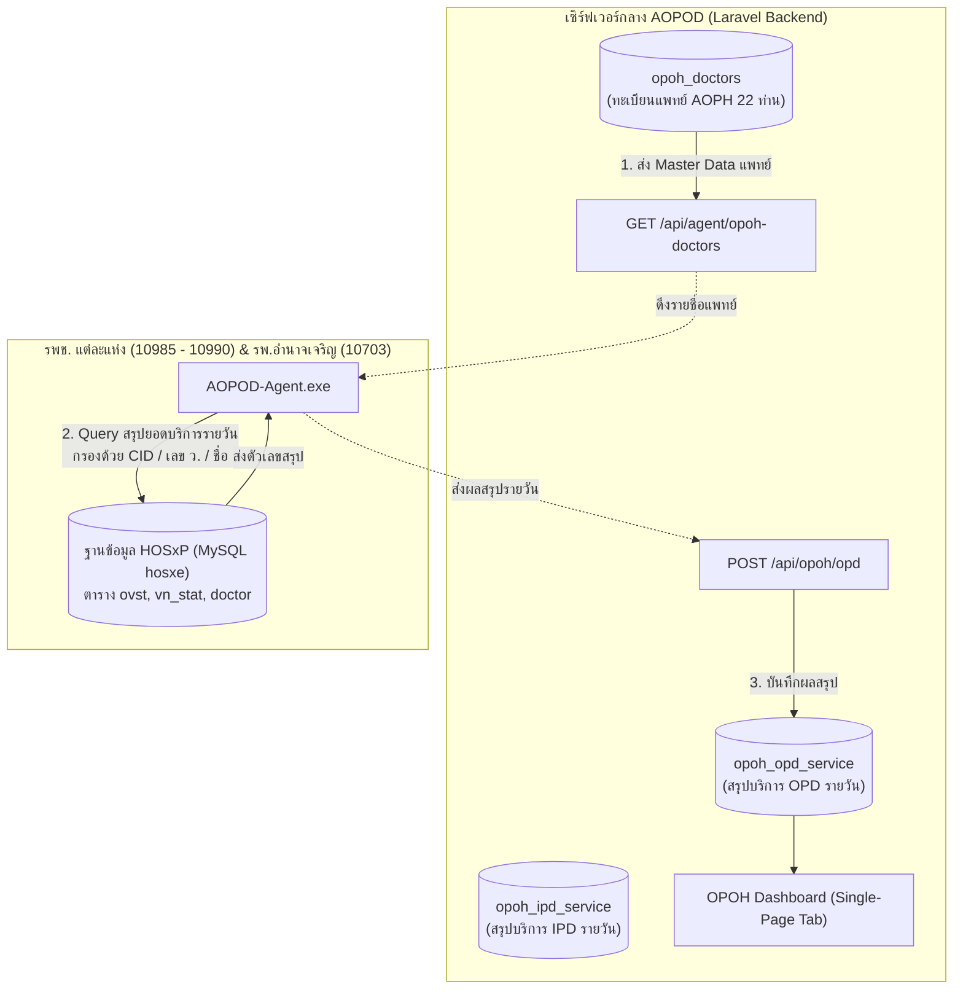

# ข้อกำหนดและคู่มือสถาปัตยกรรมระบบ OPOH / AOPH Service
## (One Region One Province One Hospital System Specification)
### โครงการระบบศูนย์กลางข้อมูลสารสนเทศทางการแพทย์ จ.อำนาจเจริญ (AOPOD)

---

## 1. บทนำและวัตถุประสงค์ (Overview & Objectives)

ระบบ **OPOH (One Region One Province One Hospital)** หรือ **AOPH (Amnat One Province Hospital)** พัฒนาขึ้นเพื่อติดตาม ประเมินผล และนับจำนวนเคสบริการทางการแพทย์ของ **แพทย์เฉพาะทางจากโรงพยาบาลศูนย์/ทั่วไป (รพ.อำนาจเจริญ รหัส 10703)** ที่หมุนเวียนออกไปตรวจรักษาและทำหัตถการ ณ **โรงพยาบาลชุมชน (รพช.) 6 แห่ง** ในจังหวัดอำนาจเจริญ:
1. `10985` - รพ.ชานุมาน
2. `10986` - รพ.ปทุมราชวงศา
3. `10987` - รพ.พนา
4. `10988` - รพ.เสนางคนิคม
5. `10989` - รพ.หัวตะพาน
6. `10990` - รพ.ลืออำนาจ
*(และเก็บสถิติของ รพ.อำนาจเจริญ `10703` ด้วย เพื่อใช้วัดอัตราการลดความแออัดและเปรียบเทียบภาระงาน)*

### วัตถุประสงค์หลัก:
* แสดงผลสถิติผู้มารับบริการแบบ **สรุปรายสัปดาห์ (Weekly)** และ **ยอดสะสม (Cumulative)**
* จำแนกข้อมูลตาม **โรงพยาบาลชุมชน** และ **สาขาความเชี่ยวชาญ (7 สาขาหลัก)**
* ตรวจสอบสิทธิการรักษาหลัก (บัตรทอง UCS, ข้าราชการ OFC, อปท. LGO, ประกันสังคม SSS)
* รายงานด้านการเงินรวม และผลลัพธ์การรักษา (ส่งต่อกลับ รพ.อำนาจเจริญ หรือ Admit รพช.)
* ปฏิบัติตามมาตรฐานความปลอดภัยและ **PDPA 100%** โดยสรุปข้อมูลแบบ Aggregation ที่ระดับ Edge/HIS ก่อนส่งเข้า Server กลาง

---

## 2. แผนภาพสถาปัตยกรรมการทำงาน (System Architecture)



---

## 3. โครงสร้างฐานข้อมูล (Database Schema)

### 3.1 ตาราง `opoh_doctors` (ทะเบียนแพทย์ AOPH)
เก็บรายชื่อแพทย์เฉพาะทางจาก รพ.แม่ข่าย มีไฟล์ Seeder เตรียมไว้ที่ `docs/opoh_doctor_seeder.json`

```sql
CREATE TABLE `opoh_doctors` (
  `id` BIGINT UNSIGNED AUTO_INCREMENT PRIMARY KEY,
  `pname` VARCHAR(50) NULL COMMENT 'คำนำหน้าชื่อ (นพ., พญ.)',
  `fname` VARCHAR(100) NOT NULL COMMENT 'ชื่อ',
  `lname` VARCHAR(100) NOT NULL COMMENT 'นามสกุล',
  `doctor_name` VARCHAR(150) NOT NULL COMMENT 'คำนำหน้า-ชื่อ-สกุล',
  `cid` VARCHAR(13) NULL COMMENT 'เลขประจำตัวประชาชน 13 หลัก',
  `licenseno` VARCHAR(20) NULL COMMENT 'เลขที่ใบประกอบวิชาชีพเวชกรรม (เลข ว.)',
  `spclty_code` VARCHAR(10) NOT NULL COMMENT 'รหัสสาขาเฉพาะทาง (01, 02, 05, 06, 07, 08)',
  `specialty_name` VARCHAR(100) NOT NULL COMMENT 'ชื่อสาขาเฉพาะทาง',
  `position` VARCHAR(150) NULL COMMENT 'ตำแหน่งทางการแพทย์',
  `is_active` ENUM('Y', 'N') DEFAULT 'Y' COMMENT 'สถานะเปิดใช้งาน',
  `created_by` BIGINT UNSIGNED NULL COMMENT 'User ID ผู้สร้าง',
  `created_at` TIMESTAMP NULL,
  `updated_at` TIMESTAMP NULL,
  INDEX idx_doctor_lookup (`cid`, `licenseno`, `is_active`)
);
```

### 3.2 ตาราง `opoh_opd_service` (สรุปยอดบริการผู้ป่วยนอก AOPH รายวัน)
```sql
CREATE TABLE `opoh_opd_service` (
  `id` BIGINT UNSIGNED AUTO_INCREMENT PRIMARY KEY,
  `hospcode` VARCHAR(10) NOT NULL COMMENT 'รหัส รพ. ปลายทางที่ให้บริการ',
  `vstdate` DATE NOT NULL COMMENT 'วันที่ตรวจ',
  `spclty_code` VARCHAR(10) NOT NULL COMMENT 'รหัสสาขาเฉพาะทาง',
  `specialty_name` VARCHAR(100) NOT NULL COMMENT 'ชื่อสาขา',
  
  -- จำนวนผู้รับบริการ
  `hn_total` INT UNSIGNED DEFAULT 0 COMMENT 'จำนวนผู้ป่วย (ราย/คน)',
  `visit_total` INT UNSIGNED DEFAULT 0 COMMENT 'จำนวนครั้งที่ตรวจ (Visit)',
  
  -- สิทธิการรักษา 4 กองทุนหลัก + อื่นๆ
  `visit_ucs` INT UNSIGNED DEFAULT 0 COMMENT 'สิทธิบัตรทอง (UCS)',
  `visit_ofc` INT UNSIGNED DEFAULT 0 COMMENT 'สิทธิข้าราชการ (OFC)',
  `visit_lgo` INT UNSIGNED DEFAULT 0 COMMENT 'สิทธิ อปท. (LGO)',
  `visit_sss` INT UNSIGNED DEFAULT 0 COMMENT 'สิทธิประกันสังคม (SSS)',
  `visit_other` INT UNSIGNED DEFAULT 0 COMMENT 'สิทธิอื่นๆ / ชำระเงิน',
  
  -- ผลลัพธ์หลังตรวจ (Outcomes)
  `refer_to_origin` INT UNSIGNED DEFAULT 0 COMMENT 'ส่งต่อกลับไป รพ.อำนาจเจริญ (10703)',
  `admit_ipd` INT UNSIGNED DEFAULT 0 COMMENT 'รับไว้นอน รพช. (Admit)',
  
  `created_at` TIMESTAMP NULL,
  `updated_at` TIMESTAMP NULL,
  UNIQUE KEY uk_opoh_opd (`hospcode`, `vstdate`, `spclty_code`),
  INDEX idx_vstdate (`vstdate`),
  INDEX idx_hospcode (`hospcode`)
);
```

### 3.3 ตาราง `opoh_ipd_service` (สรุปยอดบริการผู้ป่วยใน / ผ่าตัด รายวัน)
```sql
CREATE TABLE `opoh_ipd_service` (
  `id` BIGINT UNSIGNED AUTO_INCREMENT PRIMARY KEY,
  `hospcode` VARCHAR(10) NOT NULL,
  `dchdate` DATE NOT NULL COMMENT 'วันที่จำหน่าย (หรือ admdate)',
  `spclty_code` VARCHAR(10) NOT NULL,
  `specialty_name` VARCHAR(100) NOT NULL,
  
  `an_total` INT UNSIGNED DEFAULT 0 COMMENT 'จำนวนผู้ป่วยใน (ราย)',
  `admdate_total` INT UNSIGNED DEFAULT 0 COMMENT 'วันนอนสะสมรวม',
  `adjrw_total` DECIMAL(10,4) DEFAULT 0.0000 COMMENT 'ผลรวม AdjRW',
  `operation_total` INT UNSIGNED DEFAULT 0 COMMENT 'จำนวนเคสผ่าตัด/หัตถการ',
  
  `created_at` TIMESTAMP NULL,
  `updated_at` TIMESTAMP NULL,
  UNIQUE KEY uk_opoh_ipd (`hospcode`, `dchdate`, `spclty_code`)
);
```

### 3.4 ตาราง `opoh_income_categories` (หมวดค่ารักษา 16 หมวด DRG x 6 สิทธิมาตรฐาน - Single Source of Truth ด้านการเงิน)
```sql
CREATE TABLE `opoh_income_categories` (
  `id` BIGINT UNSIGNED AUTO_INCREMENT PRIMARY KEY,
  `hospcode` VARCHAR(10) NOT NULL COMMENT 'รหัส รพ.',
  `vstdate` DATE NOT NULL COMMENT 'วันที่รับบริการ',
  `service_type` ENUM('OPD', 'IPD') NOT NULL COMMENT 'ประเภทบริการ',
  `spclty_code` VARCHAR(10) NULL COMMENT 'รหัสสาขาเฉพาะทาง',
  `doctor_id` BIGINT UNSIGNED NULL COMMENT 'ID แพทย์ AOPH (ถ้ามี)',
  `drg_chrgitem_id` INT UNSIGNED NOT NULL COMMENT 'รหัสหมวดค่ารักษา 1-16 (drg_chrgitem)',
  `drg_chrgitem_name` VARCHAR(255) NOT NULL COMMENT 'ชื่อหมวดค่ารักษา',
  `inc_ucs_incup` DECIMAL(12,2) DEFAULT 0.00 COMMENT 'สิทธิประกันสุขภาพในจังหวัด',
  `inc_ucs_outprov` DECIMAL(12,2) DEFAULT 0.00 COMMENT 'สิทธิประกันสุขภาพต่างจังหวัด',
  `inc_ofc` DECIMAL(12,2) DEFAULT 0.00 COMMENT 'สิทธิข้าราชการ/เบิกต้นสังกัด',
  `inc_lgo` DECIMAL(12,2) DEFAULT 0.00 COMMENT 'สิทธิองค์กรปกครองส่วนท้องถิ่น (อปท.)',
  `inc_sss` DECIMAL(12,2) DEFAULT 0.00 COMMENT 'สิทธิประกันสังคม',
  `inc_other` DECIMAL(12,2) DEFAULT 0.00 COMMENT 'สิทธิชำระเงิน/อื่นๆ',
  `inc_total` DECIMAL(12,2) DEFAULT 0.00 COMMENT 'ยอดรวมทุกสิทธิ',
  `created_at` TIMESTAMP NULL,
  `updated_at` TIMESTAMP NULL,
  INDEX idx_hosp_vst_type (`hospcode`, `vstdate`, `service_type`),
  INDEX idx_cat_vst (`drg_chrgitem_id`, `vstdate`),
  INDEX idx_doc_vst (`doctor_id`, `vstdate`)
);
```

### 3.5 เพิ่มฟิลด์สิทธิ์ในตาราง `users`
เพิ่ม 2 ฟิลด์ตามมาตรฐานระบบ AOPOD เดิม:
```sql
ALTER TABLE `users` 
ADD COLUMN `allow_opoh` TINYINT(1) DEFAULT 0 COMMENT 'สิทธิ์จัดการแพทย์ OPOH (เพิ่ม/ลบ/แก้ไข)' AFTER `allow_aemr`,
ADD COLUMN `allow_opoh_dashboard` TINYINT(1) DEFAULT 0 COMMENT 'สิทธิ์ดู Dashboard OPOH (Read-Only)' AFTER `allow_opoh`;
```

---

## 4. ระบบการกำหนดสิทธิ์ (Roles & Permissions)

โครงสร้างสิทธิ์ใน Model `app/Models/User.php`:

```php
/**
 * สิทธิ์การจัดการแพทย์และตั้งค่า OPOH (Admin หรือผู้รับผิดชอบที่ได้ allow_opoh)
 */
public function canAccessOpoh(): bool
{
    return $this->isAdmin() || (bool)$this->allow_opoh;
}

/**
 * สิทธิ์การดู Dashboard OPOH (ผู้จัดการจะดูได้อัตโนมัติ หรือผู้ที่ได้ allow_opoh_dashboard)
 */
public function canAccessOpohDashboard(): bool
{
    return $this->canAccessOpoh() || (bool)$this->allow_opoh_dashboard;
}
```

### เมทริกซ์สิทธิ์ (Permission Matrix):
| สิทธิ์ผู้ใช้ | ดู Dashboard สรุปเคส | เพิ่ม / แก้ไข / เปิด-ปิดแพทย์ | ปุ่มที่แสดงบน UI |
| :--- | :---: | :---: | :--- |
| **Admin** (`role = 'admin'`) | ✅ | ✅ | แสดงครบทุกอย่าง + ปุ่มตั้งค่า |
| **ผู้รับผิดชอบงาน** (`allow_opoh = 1`) | ✅ | ✅ | แสดง Dashboard + ปุ่มจัดการแพทย์ |
| **ผู้บริหาร / ผู้ใช้ทั่วไป** (`allow_opoh_dashboard = 1`) | ✅ | ❌ | แสดง Dashboard อย่างเดียว (ซ่อนปุ่มจัดการ) |
| **ไม่มีสิทธิ์** (`0 ทั้งคู่`) | ❌ | ❌ | แสดง Error 403 / ไม่แสดงเมนู |

---

## 5. รายชื่อแพทย์ Master Data (22 ท่าน 7 สาขา)

ไฟล์ Seeder อยู่ที่ **`docs/opoh_doctor_seeder.json`**

| สาขา | รหัสสาขา | รายชื่อแพทย์ | เลข ว. / ข้อมูลตรวจพบ |
| :--- | :---: | :--- | :--- |
| **อายุรกรรม** | `01` | 1. นพ.ปริญญา นพเก้า | ว29520 (CID: 3320100707159) |
| | | 2. นพ.วีระชัย ชาติชัชวาล | ว29561 (CID: 3349900434112) |
| | | 3. พญ.ดวงนภา จันเทวา | ว36921 (CID: 5341600098868) - อายุรแพทย์โรคไต |
| | | 4. พญ.ประภัสสรณ์ ศาลารมย์ | ว44947 (CID: 1341700032718) |
| | | 5. นพ.พิชิต ส่องวิริยวิทยา | ว27453 (CID: 3341600116554) |
| | | 6. นพ.วิษณุ สีนุ | ว62474 (CID: 1370100022591) |
| | | 7. พญ.ลดารัตน์ สุริยวงศ์ | *(จับคู่ด้วยชื่อ-สกุล)* |
| | | 8. พญ.จิรารัตน์ บุดดาวงศ์ | *(จับคู่ด้วยชื่อ-สกุล)* |
| | | 9. นพ.กมลศักดิ์ อุ่นตา | *(จับคู่ด้วยชื่อ-สกุล)* |
| | | 10. พญ.มิลลิกา คำเกษ | *(จับคู่ด้วยชื่อ-สกุล)* |
| **กุมารเวชกรรม** | `05` | 11. พญ.วิชญา บุดดาวงศ์ | *(จับคู่ด้วยชื่อ-สกุล)* |
| **ศัลยกรรมกระดูกและข้อ** | `06` | 12. นพ.พิพัฒน์ ตันวาณิชกุล | ว42398 (CID: 8479988001896) |
| | | 13. นพ.ชวนินทร์ เลิศพงศ์ไพบูลย์ | ว55542 (CID: 1103300112793) |
| | | 14. นพ.ต๋อง ดารุณ | *(จับคู่ด้วยชื่อ-สกุล)* |
| | | 15. นพ.เกียรติยศ จันทร์สมุด | *(จับคู่ด้วยชื่อ-สกุล)* |
| **จิตเวช** | `07` | 16. นพ.อธิปวัฒน์ บุญเรือง | ว64881 (CID: 1379900015695) |
| **ศัลยกรรมทั่วไป** | `02` | 17. พญ.อภิษฎา เวชกรณ์ | ว24873 (CID: 3341601111811) |
| | | 18. นพ.เกียรติตระกูล กองทอง | *(จับคู่ด้วยชื่อ-สกุล)* |
| **สูตินรีเวช** | `03` | 19. พญ.ชินรัตน์ ตั้งอุไทกูลย์ | ว17839 (CID: 3329900024496) |
| | | 20. พญ.พิมพ์ดาว โสวาปี | ว49500 (CID: 1349900313297) |
| **จักษุ** | `08` | 21. พญ.จิราภรณ์ บุดดาวงศ์ | ว53579 (CID: 1349900449695) |
| | | 22. พญ.พรภัทรา ผ่องแผ้ว | *(จับคู่ด้วยชื่อ-สกุล)* |

---

## 6. คำสั่ง SQL สำหรับ Agent ดึงข้อมูลจาก HOSxP

SQL นี้จะรันที่เครื่องแม่ข่าย รพช. โดย AOPOD-Agent:

```sql
SELECT 
    ov.vstdate,
    d.spclty AS spclty_code,
    COALESCE(sp.name, 'ไม่ระบุสาขา') AS specialty_name,
    COUNT(DISTINCT ov.hn) AS hn_total,
    COUNT(ov.vn) AS visit_total,
    
    -- จำแนกสิทธิ 4 กองทุนหลัก + อปท. (LGO)
    SUM(CASE WHEN p.hipdata_code IN ('UCS','WEL','DIS') THEN 1 ELSE 0 END) AS visit_ucs,
    SUM(CASE WHEN p.hipdata_code = 'OFC' THEN 1 ELSE 0 END) AS visit_ofc,
    SUM(CASE WHEN p.hipdata_code = 'LGO' THEN 1 ELSE 0 END) AS visit_lgo,
    SUM(CASE WHEN p.hipdata_code IN ('SSS','SSI') THEN 1 ELSE 0 END) AS visit_sss,
    SUM(CASE WHEN (p.hipdata_code NOT IN ('UCS','WEL','DIS','OFC','LGO','SSS','SSI') OR p.paidst IN ('01','03')) THEN 1 ELSE 0 END) AS visit_other,
    
    -- การเงินรวม
    COALESCE(SUM(v.income), 0) AS inc_total,
    COALESCE(SUM(v.inc12), 0) AS inc_drug_total,
    COALESCE(SUM(v.inc03), 0) AS inc_lab_total,
    
    -- ผลลัพธ์การตรวจ
    COUNT(DISTINCT CASE WHEN ro.refer_hospcode = '10703' THEN ov.vn END) AS refer_to_origin,
    COUNT(DISTINCT CASE WHEN ipt.an IS NOT NULL THEN ov.vn END) AS admit_ipd

FROM ovst ov
JOIN vn_stat v ON v.vn = ov.vn
JOIN doctor d ON d.code = ov.doctor
LEFT JOIN spclty sp ON sp.spclty = d.spclty
LEFT JOIN pttype p ON p.pttype = ov.pttype
LEFT JOIN referout ro ON ro.vn = ov.vn
LEFT JOIN ipt ON ipt.vn = ov.vn
WHERE ov.vstdate BETWEEN ? AND ?
  -- กรองด้วย CID, เลข ว. และชื่อแพทย์ AOPH 22 ท่าน
  AND (
      d.cid IN ({{OPOH_DOCTOR_CIDS}})
      OR d.licenseno IN ({{OPOH_DOCTOR_LICENSES}})
      OR d.name LIKE '%ลดารัตน์%'
      OR d.name LIKE '%กมลศักดิ์%'
      OR d.name LIKE '%มิลลิกา%'
      OR d.name LIKE '%วิชญา%'
      OR d.name LIKE '%ต๋อง%'
      OR d.name LIKE '%เกียรติยศ%'
      OR d.name LIKE '%เกียรติตระกูล%'
      OR d.name LIKE '%พรภัทรา%'
      OR d.name LIKE '%จิรารัตน์%'
  )
GROUP BY ov.vstdate, d.spclty, sp.name
ORDER BY ov.vstdate, d.spclty;
```

---

## 7. ข้อมูล API สำหรับ Agent

### 7.1 `GET /api/agent/opoh-doctors`
ให้ Agent ขอรับรายชื่อแพทย์ AOPH (อัปเดตแคชอัตโนมัติ)
* **Response Body:**
```json
{
  "status": "success",
  "count": 22,
  "cids": ["3320100707159", "3349900434112", "..."],
  "licenses": ["ว29520", "ว29561", "ว64881", "..."],
  "names": ["ลดารัตน์", "กมลศักดิ์", "ต๋อง", "..."]
}
```

### 7.2 `POST /api/opoh/opd`
รับข้อมูลสรุปรายวันจาก Agent (ผ่าน Middleware `auth:sanctum` และตรวจความถูกต้องของ Token รพ.)
* **Payload:**
```json
{
  "records": [
    {
      "vstdate": "2026-09-16",
      "spclty_code": "06",
      "specialty_name": "ศัลยกรรมกระดูกและข้อ",
      "hn_total": 12,
      "visit_total": 12,
      "visit_ucs": 10,
      "visit_ofc": 2,
      "visit_lgo": 0,
      "visit_sss": 0,
      "visit_other": 0,
      "inc_total": 15400.00,
      "inc_drug_total": 8200.00,
      "inc_lab_total": 1500.00,
      "refer_to_origin": 1,
      "admit_ipd": 0
    }
  ]
}
```

---

## 8. ผังหน้าจอ Dashboard (Single-Page Blueprint)

หน้าจอ `resources/views/dashboard_opoh.blade.php` ออกแบบเป็น **Tab เดียว** ตาม Infographic:

```
+---------------------------------------------------------------------------------------+
|  [ โลโก้ สธ. / AOPOD ]  ONE REGION ONE PROVINCE ONE HOSPITAL (จ.อำนาจเจริญ)          |
|  [ปุ่มเลือกสัปดาห์/ปีงบประมาณ]                                 [ปุ่มจัดการแพทย์ AOPH]  |
+---------------------------------------------------------------------------------------+
|  [ การ์ดสถิติสะสมแยกรายสาขา (Total Cumulative Cards) ]                               |
|  [อายุรกรรม 2,292] [ศัลย์ 362] [กระดูก 609] [สูติ 46] [เด็ก 266] [จิตเวช 636] [จักษุ 55]|
+---------------------------------------------------------------------------------------+
|  [ ตารางหลักสรุปราย รพช. (Community Hospital Breakdown Table) ]                       |
|  โรงพยาบาล        | สะสมอดีต (ราย)    | สัปดาห์ปัจจุบัน (ราย) | ยอดสะสมรวม (ราย)       |
|  -----------------------------------------------------------------------------------  |
|  รพ.ลืออำนาจ      | 613               | 9                   | 622                   |
|  รพ.ปทุมราชวงศา   | 1,143             | 48                  | 1,191                 |
|  รพ.หัวตะพาน      | 829               | 63                  | 892                   |
|  รพ.เสนางคนิคม    | 407               | 43                  | 450                   |
+---------------------------------------------------------------------------------------+
|  [ สรุปด้านการเงินและสิทธิการรักษา (Financial & Insurance Schemes) ]                  |
|  - สิทธิบัตรทอง (UCS) | ข้าราชการ (OFC) | อปท. (LGO) | ประกันสังคม (SSS)              |
|  - ค่าบริการรวมทั้งหมด | ค่ายารวม | ค่าแล็บรวม | ส่งต่อกลับ รพ.อำนาจเจริญ               |
+---------------------------------------------------------------------------------------+
```

---

## 9. แผนการลงมือทำเมื่อกลับมาทำต่อ (Action Checklist)

เมื่อกลับมาทำงานต่อ สามารถทำตามลำดับขั้นตอน (Step-by-Step) ได้ทันที:

- [ ] **Step 1:** รันคำสั่งสร้าง Migration:
  - `php artisan make:migration create_opoh_tables`
  - สร้างตาราง `opoh_doctors`, `opoh_opd_service`, `opoh_ipd_service` และเพิ่มฟิลด์สิทธิ์ใน `users`
- [ ] **Step 2:** สร้าง Models:
  - `app/Models/OpohDoctor.php`
  - `app/Models/OpohOpdService.php`
  - `app/Models/OpohIpdService.php`
  - เพิ่มเมธอดสิทธิ์ `canAccessOpoh()` และ `canAccessOpohDashboard()` ใน `app/Models/User.php`
- [ ] **Step 3:** สร้าง Seeder:
  - `database/seeders/OpohDoctorSeeder.php` ดึงข้อมูลจาก `opoh_doctor_seeder.json` มาบันทึกลงตาราง
- [ ] **Step 4:** สร้าง Controller & API:
  - `app/Http/Controllers/Web/DashboardOpohController.php` (หน้าจอ Dashboard)
  - `app/Http/Controllers/Api/OpohApiController.php` (รับข้อมูลจาก Agent)
  - ประกาศ Route ใน `routes/web.php` และ `routes/api.php`
- [ ] **Step 5:** สร้าง View:
  - `resources/views/dashboard_opoh.blade.php` (UI สรุปตัวเลขตาม Infographic)
  - Modal จัดการแพทย์ AOPH (สำหรับผู้มีสิทธิ์)
- [ ] **Step 6:** ปรับตั้งค่า Query ใน AOPOD-Agent และทดสอบดึงข้อมูลจริง

